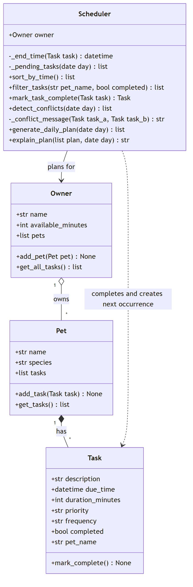

# 🐾 PawPal+

PawPal+ is a Streamlit app that helps a busy pet owner stay on top of pet care. You add your pets and their care tasks (walks, feeding, meds, grooming, and so on), and PawPal+ builds today's plan around the time you have. It picks the most important tasks first, warns you when tasks overlap, keeps daily and weekly tasks coming back automatically, and explains why it chose the plan it did.

## ✨ Features

- **Multiple pets, one plan:** an owner can have any number of pets, and the scheduler always plans across all of them.
- **Sorting by time:** tasks are listed in chronological order, no matter what order they were added in (`Scheduler.sort_by_time()`).
- **Filtering:** show tasks for one pet, only tasks still to do, only completed tasks, or any combination (`Scheduler.filter_tasks()`).
- **Daily recurrence:** marking a daily task done automatically adds tomorrow's, and a weekly task adds next week's. One-time tasks don't repeat (`Scheduler.mark_task_complete()`).
- **Conflict warnings:** flags two tasks at the exact same time, or tasks whose durations overlap, for the same pet or different pets. It warns instead of crashing (`Scheduler.detect_conflicts()`).
- **Priority-based daily plan:** picks high, then medium, then low priority tasks until the owner's available minutes run out, and shows them in time order (`Scheduler.generate_daily_plan()`).
- **Plan explanation:** says why each task was included or skipped, and lists any conflicts (`Scheduler.explain_plan()`).
- **Input checks:** rejects invalid priorities, frequencies and durations when a task is created.

## 🚀 Getting started

```bash
python -m venv .venv
source .venv/bin/activate  # Windows: .venv\Scripts\activate
pip install -r requirements.txt
```

| What | Command |
|------|---------|
| Run the Streamlit app | `streamlit run app.py` |
| Run the terminal demo | `python main.py` |
| Run the tests | `python -m pytest` |

## 🧩 Implementation Summary

PawPal+ plans an owner's pet care day across multiple pets. All the logic lives in `pawpal_system.py`, which has four classes:

- **`Task`** (dataclass): one care activity, with a description, due time, duration, priority (`high`/`medium`/`low`), frequency (`once`/`daily`/`weekly`) and a completed flag. It rejects invalid priorities, frequencies and durations, and `mark_complete()` marks it done.
- **`Pet`** (dataclass): a pet's name, species and task list. `add_task()` adds a task and tags it with the pet's name.
- **`Owner`** (dataclass): the owner's name, how many minutes they have for pet care, and their pets. `get_all_tasks()` returns every pet's tasks in one list.
- **`Scheduler`**: the "brain." It holds an `Owner` and gets all of its data through `owner.get_all_tasks()`, so every pet is included. It can:
  - sort tasks by time and filter them by pet or completion status
  - complete tasks, automatically adding the next copy of daily and weekly tasks
  - detect tasks whose times overlap
  - build a daily plan by picking the highest-priority unfinished tasks that fit in the owner's available minutes
  - explain why each task was included or skipped

**How they work together:** an `Owner` has many `Pet`s, and each `Pet` has many `Task`s. The `Scheduler` never reaches into a single pet. It asks the `Owner` for all tasks, so adding a pet automatically includes its tasks in the plan. `main.py` is a demo script that builds an owner with two pets and shows sorting, filtering, conflict warnings, today's schedule and recurring tasks. `app.py` is the Streamlit UI for the same classes. `tests/test_pawpal.py` holds the pytest tests. The final class diagram is `diagrams/uml_final.mmd` (`diagrams/uml_draft.mmd` is the working draft):



## 🖥️ Sample Output

Output from running `python main.py` (an owner with two pets and seven tasks, added out of order):

```text
Unsorted: as stored, pet by pet (get_all_tasks)
========================================
Sun 05:30 PM  Brushing           Rex   weekly  [todo]
Sun 08:00 AM  Morning walk       Rex   daily   [todo]
Sun 07:30 AM  Breakfast          Rex   daily   [todo]
Sun 07:00 PM  Litter box clean   Milo  daily   [todo]
Sun 12:00 PM  Feather toy play   Milo  once    [todo]
Sun 08:15 AM  Give meds          Milo  daily   [todo]
Sun 07:30 AM  Breakfast          Milo  daily   [todo]

Sorted by time (sort_by_time)
========================================
Sun 07:30 AM  Breakfast          Rex   daily   [todo]
Sun 07:30 AM  Breakfast          Milo  daily   [todo]
Sun 08:00 AM  Morning walk       Rex   daily   [todo]
Sun 08:15 AM  Give meds          Milo  daily   [todo]
Sun 12:00 PM  Feather toy play   Milo  once    [todo]
Sun 05:30 PM  Brushing           Rex   weekly  [todo]
Sun 07:00 PM  Litter box clean   Milo  daily   [todo]

Only Milo's tasks (filter_tasks pet_name='Milo')
========================================
Sun 07:00 PM  Litter box clean   Milo  daily   [todo]
Sun 12:00 PM  Feather toy play   Milo  once    [todo]
Sun 08:15 AM  Give meds          Milo  daily   [todo]
Sun 07:30 AM  Breakfast          Milo  daily   [todo]

Conflict warnings for today (detect_conflicts)
========================================
WARNING: Rex's 'Breakfast' (07:30-07:40) is at the same time as Milo's 'Breakfast' (07:30-07:40)
WARNING: Rex's 'Morning walk' (08:00-08:30) overlaps Milo's 'Give meds' (08:15-08:20)

Today's Schedule (Sunday, October 18)
========================================
07:30 AM  Breakfast          Rex    10 min  [high]
07:30 AM  Breakfast          Milo   10 min  [high]
08:00 AM  Morning walk       Rex    30 min  [high]
08:15 AM  Give meds          Milo    5 min  [high]
12:00 PM  Feather toy play   Milo   20 min  [medium]
05:30 PM  Brushing           Rex    15 min  [low]

Plan for Jose: 6 task(s), 90 of 90 minutes used.
Tasks are picked by priority (high, then medium, then low); ties go to the earlier task.
- 07:30 Breakfast (Rex, high priority, 10 min): included, it fit in the remaining time.
- 07:30 Breakfast (Milo, high priority, 10 min): included, it fit in the remaining time.
- 08:00 Morning walk (Rex, high priority, 30 min): included, it fit in the remaining time.
- 08:15 Give meds (Milo, high priority, 5 min): included, it fit in the remaining time.
- 12:00 Feather toy play (Milo, medium priority, 20 min): included, it fit in the remaining time.
- 17:30 Brushing (Rex, low priority, 15 min): included, it fit in the remaining time.
- Skipped Litter box clean (Milo, medium priority, 45 min): needed 45 min but only 0 were left.
Warnings:
- Rex's 'Breakfast' (07:30-07:40) is at the same time as Milo's 'Breakfast' (07:30-07:40)
- Rex's 'Morning walk' (08:00-08:30) overlaps Milo's 'Give meds' (08:15-08:20)

Recurring tasks (mark_task_complete)
========================================
Completed Rex's 'Morning walk' due Sun 08:00 AM.
Next one was created automatically, due Mon 08:00 AM.
Completed Milo's 'Feather toy play' (once), so no next one was created.

Completed tasks (filter_tasks completed=True)
========================================
Sun 08:00 AM  Morning walk       Rex   daily   [done]
Sun 12:00 PM  Feather toy play   Milo  once    [done]

Rex's tasks still to do, sorted (filter + sort)
========================================
Sun 07:30 AM  Breakfast          Rex   daily   [todo]
Sun 05:30 PM  Brushing           Rex   weekly  [todo]
Mon 08:00 AM  Morning walk       Rex   daily   [todo]
```

## 🧪 Testing PawPal+

Run the tests from the project folder:

```bash
python -m pytest
```

The suite in `tests/test_pawpal.py` has 29 tests covering both normal use ("happy paths") and edge cases:

- **Sorting:** tasks added out of order come back in time order; no tasks gives an empty list.
- **Filtering:** by pet (any capitalization), by done/not done, both together, and a pet with no tasks.
- **Recurring tasks:** completing a daily task creates one for the next day, and a weekly task one for 7 days later. Oct 31 rolls over to Nov 1. "Once" tasks don't repeat, completing twice doesn't create duplicates, and a task from another owner raises an error.
- **Conflict detection:** two tasks at the exact same time are flagged, as are overlapping tasks for the same pet. Back-to-back tasks, completed tasks, other days and an empty schedule produce no warnings.
- **Daily plan:** high priority is picked first within the available minutes; completed tasks and other days are skipped; nothing fitting gives an empty plan; the explanation lists included tasks, skipped tasks and conflicts.
- **Input checks:** an invalid priority, frequency or duration is rejected, and `" High "` / `"DAILY"` are normalized.

To make sure the tests are meaningful and not just passing, I broke the code on purpose (e.g. counting back-to-back tasks as conflicts, repeating daily tasks every 2 days, ignoring priority) and checked that the right test failed each time. This caught one weak test, which I then fixed.

Output of a successful run:

```text
============================= test session starts =============================
platform win32 -- Python 3.12.1, pytest-9.1.1, pluggy-1.6.0
rootdir: C:\Users\huert\Desktop\CodePathAI\Project2\ai110-module2show-pawpal-starter
configfile: pytest.ini
testpaths: tests
collected 29 items

tests\test_pawpal.py .............................                       [100%]

============================= 29 passed in 0.06s ==============================
```

**Confidence Level: ⭐⭐⭐⭐ (4/5)**

All 29 tests pass, and they fail when the scheduling logic is deliberately broken, so I trust the core behavior: sorting, filtering, recurrence, conflicts and the daily plan. It isn't 5 stars because the Streamlit UI is only tested by hand, and the planner picks tasks highest priority first, which doesn't always find the best possible combination of tasks.

## 📐 Smarter Scheduling

| Feature | Method(s) | Notes |
|---------|-----------|-------|
| Task sorting | `Scheduler.sort_by_time()` | Earliest due time first, across all pets |
| Filtering | `Scheduler.filter_tasks(pet_name, completed)` | By pet (any capitalization), by done/not done, or both |
| Conflict handling | `Scheduler.detect_conflicts(day)` | Warns about overlapping durations, not just exact matches; never crashes |
| Recurring tasks | `Scheduler.mark_task_complete(task)` | Daily → next day, weekly → 7 days later; "once" tasks don't repeat |
| Daily plan | `Scheduler.generate_daily_plan(day)`, `Scheduler.explain_plan(plan, day)` | Highest priority first, within the owner's available minutes |

**Sorting:** `sort_by_time()` uses Python's `sorted()` with a lambda key, `key=lambda task: task.due_time`. Because `due_time` is a `datetime`, tasks sort by date and then time. Tasks at the same time keep the order they were added.

**Filtering:** `filter_tasks()` keeps a task only if it matches every filter given. Leaving a filter as `None` means "don't filter on this." The Streamlit app uses it for the "Show pet" and "Show status" dropdowns.

**Conflict detection:** `detect_conflicts()` sorts the unfinished tasks by time, then checks every pair with `itertools.combinations`. Two tasks clash if the later one starts before the earlier one ends (`due_time + duration_minutes`). It returns warning strings instead of raising errors. Exact matches say "is at the same time as", partial overlaps say "overlaps", and back-to-back tasks (8:00–8:30, then 8:30) don't count. It works for the same pet or different pets, and passing a `day` limits it to that day.

**Recurring tasks:** `mark_task_complete()` marks the task done. If its frequency is `daily` or `weekly`, it adds a new copy to the same pet, due `timedelta(days=1)` or `timedelta(weeks=1)` after the original due time, so it rolls over months and years correctly. Completing the same task twice doesn't create duplicates. The Streamlit app's "Mark done" button calls this method.

**Daily plan:** `generate_daily_plan()` skips completed tasks and tasks on other days. It picks tasks in priority order (ties go to the earlier task) while they fit in the owner's available minutes, then returns them in time order. `explain_plan()` says why each task was included or skipped and lists any conflicts.

## 📸 Demo Walkthrough

### What you can do in the app

Start it with `streamlit run app.py`. The page is one column, top to bottom:

- **Owner:** enter your name and how many minutes you have for pet care today.
- **Add a pet:** name and species (dog, cat, other). Empty or duplicate names are rejected with an error message.
- **Add a task:** pick the pet, then enter a description, due time, duration, priority (low/medium/high), and how often it repeats (once/daily/weekly).
- **Pets:** a table of your pets and how many tasks each has.
- **Tasks:**
  - **Mark a task done:** choose an unfinished task and click "Mark done". For a daily or weekly task, a green message confirms the next one was added, with its date.
  - **Filter:** "Show pet" (all or one pet) and "Show status" (to do / done / all). The table is always sorted by time.
  - **Conflict warning:** if any of today's tasks overlap, one yellow warning lists every conflict, with a count and a tip on how to fix it.
- **Build Schedule:** "Generate schedule" shows today's plan as a table with a summary of minutes used. It also shows a blue note listing tasks that didn't fit, the same conflict warning, and a "Why this plan?" section with the full explanation.

### Example workflow

1. Enter "Jordan" as the owner and set **90** minutes available.
2. Add two pets: **Rex** (dog) and **Milo** (cat).
3. Add tasks for Rex: *Breakfast* 7:30, 10 min, high, daily; *Morning walk* 8:00, 30 min, high, daily.
4. Add tasks for Milo: *Breakfast* 7:30, 10 min, high, daily; *Give meds* 8:15, 5 min, high, daily; *Litter box clean* 19:00, 45 min, medium.
5. The Tasks table lists all five in time order, and a warning appears: **"⚠️ 2 time conflicts today"**. Both breakfasts are at 7:30, and the walk overlaps the meds.
6. Set "Show pet" to **Milo** to see only Milo's tasks.
7. Click **Generate schedule**. The plan includes the high-priority tasks first, then fills the remaining time, and lists anything that didn't fit.
8. Select Rex's *Morning walk* and click **Mark done**. The app confirms that tomorrow's walk was added, and it appears in the task list.

### Scheduler behaviors you'll see

- **Sorting:** tasks always appear in time order, even though they were added in a different order.
- **Filtering:** the pet and status dropdowns narrow the table using `filter_tasks()`.
- **Conflict warnings:** an exact time match says "is at the same time as", and a partial overlap says "overlaps". Back-to-back tasks are not flagged.
- **Recurrence:** completing a daily task creates tomorrow's copy at the same time; one-time tasks just get marked done.
- **Priority planning:** high-priority tasks are always chosen first; lower-priority tasks fill whatever time is left.

### Sample CLI output

An excerpt from `python main.py` (the full run is in the Sample Output section above):

```text
Conflict warnings for today (detect_conflicts)
========================================
WARNING: Rex's 'Breakfast' (07:30-07:40) is at the same time as Milo's 'Breakfast' (07:30-07:40)
WARNING: Rex's 'Morning walk' (08:00-08:30) overlaps Milo's 'Give meds' (08:15-08:20)

Today's Schedule (Sunday, October 18)
========================================
07:30 AM  Breakfast          Rex    10 min  [high]
07:30 AM  Breakfast          Milo   10 min  [high]
08:00 AM  Morning walk       Rex    30 min  [high]
08:15 AM  Give meds          Milo    5 min  [high]
12:00 PM  Feather toy play   Milo   20 min  [medium]
05:30 PM  Brushing           Rex    15 min  [low]

Plan for Jose: 6 task(s), 90 of 90 minutes used.
Tasks are picked by priority (high, then medium, then low); ties go to the earlier task.
- 07:30 Breakfast (Rex, high priority, 10 min): included, it fit in the remaining time.
- 07:30 Breakfast (Milo, high priority, 10 min): included, it fit in the remaining time.
- 08:00 Morning walk (Rex, high priority, 30 min): included, it fit in the remaining time.
- 08:15 Give meds (Milo, high priority, 5 min): included, it fit in the remaining time.
- 12:00 Feather toy play (Milo, medium priority, 20 min): included, it fit in the remaining time.
- 17:30 Brushing (Rex, low priority, 15 min): included, it fit in the remaining time.
- Skipped Litter box clean (Milo, medium priority, 45 min): needed 45 min but only 0 were left.
Warnings:
- Rex's 'Breakfast' (07:30-07:40) is at the same time as Milo's 'Breakfast' (07:30-07:40)
- Rex's 'Morning walk' (08:00-08:30) overlaps Milo's 'Give meds' (08:15-08:20)

Recurring tasks (mark_task_complete)
========================================
Completed Rex's 'Morning walk' due Sun 08:00 AM.
Next one was created automatically, due Mon 08:00 AM.
Completed Milo's 'Feather toy play' (once), so no next one was created.
```
